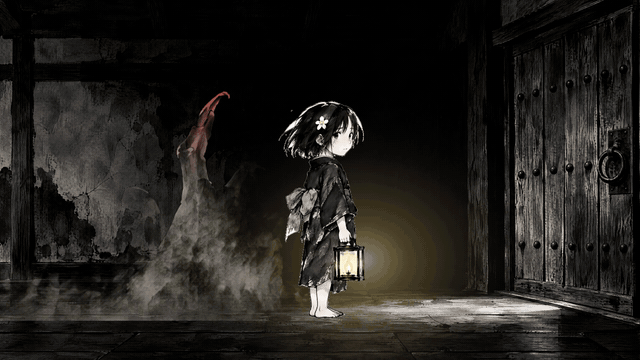
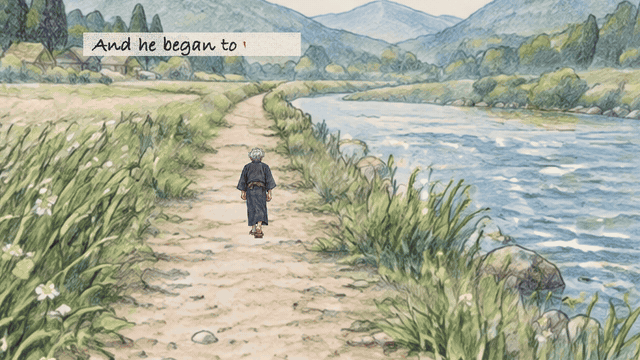
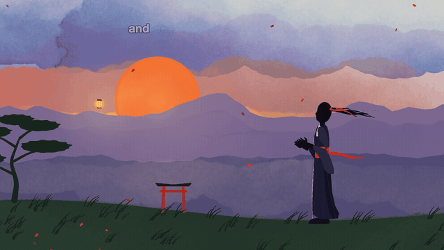
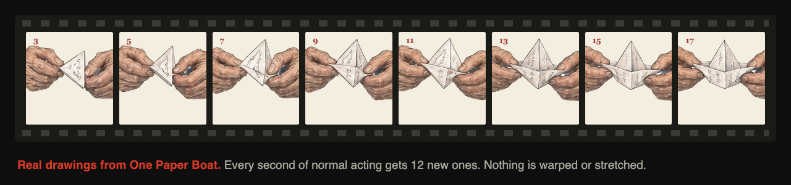
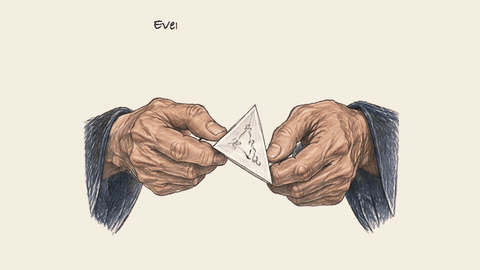
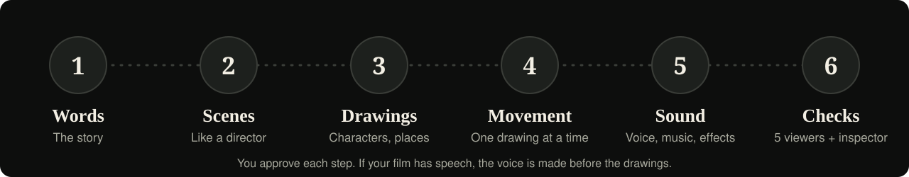
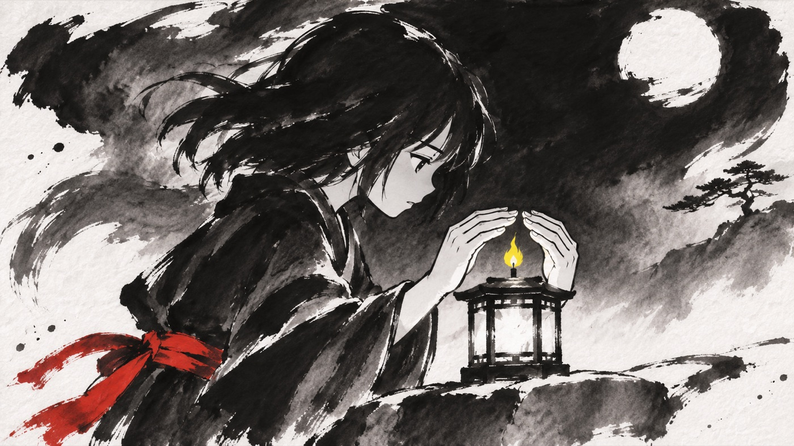

<p align="center"><a href="https://beyondtahir.github.io/beyondsumi/"></a></p>

<p align="center">


</p>

<h3 align="center">Turn your story into a Japanese animated film, one real drawing at a time.</h3>
<p align="center">Your AI assistant becomes a whole animation studio and guides you through every step.<br>No animation, editing or code needed.</p>

<p align="center">
<a href="https://beyondtahir.github.io/beyondsumi/"></a>
<a href="#install-and-make-your-first-film"></a>
</p>

<table>
<tr>
<td width="33%"><a href="https://beyondtahir.github.io/beyondsumi/#watch-dark"></a></td>
<td width="33%"><a href="https://beyondtahir.github.io/beyondsumi/#watch-light"></a></td>
<td width="33%"><a href="https://beyondtahir.github.io/beyondsumi/#watch-vector"></a></td>
</tr>
<tr>
<td align="center"><b>Sumi Dark</b> · <i>The Third Knock</i><br><sub>Black and white brush, always with vivid red and one more vibrant colour. Horror, mystery, adventure.</sub></td>
<td align="center"><b>Sumi Light</b> · <i>One Paper Boat</i><br><sub>Clear, dark colour pencil sketch. Children's stories and love stories.</sub></td>
<td align="center"><b>Sumi Vector</b> · <i>The Lantern</i><br><sub>Clean lines on painted skies, drawn in code with no images. Any story, at no image cost.</sub></td>
</tr>
</table>

## Every movement is a drawing

No warping. No morphing. No slow zoom on a still image pretending to be animation. Beyondsumi works like an old hand-drawn team, so the film moves because someone drew it moving.

<p align="center"></p>

<table>
<tr>
<td width="38%"></td>
<td>

- **12 new drawings a second** for normal acting, and 24 for fast action.
- **Small, even steps,** planned as key poses first, then in-betweens.
- **One character sheet** that every drawing follows.
- **Lip-sync** for characters seen speaking, with real drawn mouths timed to the voice.
- **Checked drawing by drawing:** head, hands, feet, physics and logic.

</td>
</tr>
</table>

## Six steps. You approve each one.

<p align="center"></p>

## You just talk. It guides you.

Two helpers are built in, written for complete beginners:

- **The first-time helper** installs and sets up everything, checks your computer and explains anything missing.
- **The film guide** takes you through every film, every time. It always says where you are, what happens next and exactly what you can reply. It asks before anything paid.

> **Step 2 of 6: planning the scenes, like a film director.**
> I suggest Sumi Light, because it suits a gentle love story. There are 11 scenes. It will take about 20 images. Nothing is made until you say yes.
>
> *You can just say: "Yes, go ahead" or "Change scene 2".*

## Bring an idea, a story or your own recording

The assistant helps write a hook and an ending that gives a clear answer, directs the scenes, draws and animates the film, and builds the sound around it. You review the script and the plan before production, and only the style you choose is made. [Make your first film, step by step](skills/sumi/references/beginner-use.md).

## Your studio

| | Role | What they do |
|---|---|---|
| 1 | **Writer** | Writes your story or fixes your script, and keeps your meaning |
| 2 | **Director** | Sees each scene first, then plans the shots, acting and camera |
| 3 | **Artist** | Draws your characters and places, and checks they make sense |
| 4 | **Animator** | Draws key poses and in-betweens, one drawing at a time |
| 5 | **Sound** | Adds the voice, music and effects, timed to the drawings |
| 6 | **Checker** | Finds big jumps, frozen frames, and cut-off heads, hands and feet |
| 7 | **Five viewers** | An anime fan, a story lover, a video maker, an art lover and a first-time viewer judge it cold |
| 8 | **Inspector** | One separate reviewer checks the final film and every instruction you gave |

You approve each step. Everything is saved in plain files, so a film can even move between assistants.

## What is Sumi art?

Sumi-e is Japanese ink painting, known for expressive brushwork, tonal washes and meaningful open space. Beyondsumi brings that spirit into animated storytelling, and the palette and direction follow your story.

## Made for storytelling channels

Make emotional stories, fables, children's tales, historical drama, documentaries, horror and mysteries. Your assistant can write the story first, direct a narrator, character dialogue or both, and build an ending that pays off the hook. [Story-writing guide](skills/sumi-writer/references/story-writing.md).

## Use the app you already have

One download, with no other skills or npm packages needed.

| App | Pictures come from | Good to know |
|---|---|---|
| **Codex** | The best image model it has | Give your film project Full access when asked, so the browser that draws and checks your film can start |
| **ChatGPT** | The best image model it has | Use Chat or Work for the story, plan and pictures. Its hosted browser could not run our film tools when we tested, so finish the film in Codex or Claude Code. [How](skills/sumi/references/install/chatgpt.md#the-chatgpt-website-and-work) |
| **Claude** | A third-party image tool you give it access to | No access? It animates in code with Sumi Vector, at no image cost |

<p align="center"><br><sub>A Sumi Dark sample made inside Codex with its own image model, and no API key.</sub></p>

## Captions that act

Captions are part of the direction: a whisper small beside a shoulder, a cry filling the frame, a word trembling at the top. They always match what is spoken.

## Sound

Every film has background music and sound effects, and the music lowers itself whenever someone speaks. There are 12 original music themes included: tender, love, grief, hope, wonder, journey, documentary, mystery, suspense, dread, battle and resolve. There are also simple free effects if you don't have paid ones, though nobody has listened to them yet. [Sound routing](skills/sumi/references/sound-routing.md).

Choose your voice:

1. [Voicebox](https://github.com/jamiepine/voicebox): a free local app. Selected models have their own requirements and licences.
2. [ElevenLabs](https://elevenlabs.io): connect an account and choose a voice. You approve paid use first.
3. **Your own voice:** record the story and send it. Scenes, captions and sound are planned around your performance. [Recording guide](skills/sumi/references/supplied-narration.md).
4. **No narration:** readable captions, music and effects lead the film.

Stories can be written in many languages, but spoken languages depend on the voice model. [Narration routes](skills/sumi/references/narration.md).

## Your film has its own dashboard

Each film comes as an HD MP4, your project files and a branded page to watch and download it. It shows all three styles, and other styles only prepare a request for your assistant, so nothing is made in secret. A local dashboard works while its local server runs. [Try the demo dashboard](https://beyondtahir.github.io/beyondsumi/dashboard/).

## Install and make your first film

**Codex:** `codex plugin marketplace add beyondtahir/beyondsumi`, then `codex plugin add beyondsumi@beyondsumi`.

**Claude Code:** `/plugin marketplace add beyondtahir/beyondsumi`, then `/plugin install beyondsumi@beyondsumi`.

Then open a new chat and say "Use Beyondsumi". Or use the ZIP:

1. [Download the latest release](https://github.com/beyondtahir/beyondsumi/releases/latest) and unpack it.
2. Install it. The easy way is to paste this into your assistant, with your folder in place of FOLDER:

   ```text
   Please install Beyondsumi for me from FOLDER. Read INSTALL.md in that folder, choose the guide for this app and do the steps yourself. I am a complete beginner, so tell me in simple words what is happening. If it needs my permission or a missing program, explain why and ask me first. When it is done, start the Beyondsumi first-time helper.
   ```

   Or follow the guide for your app in [INSTALL.md](INSTALL.md): Codex, Claude Code, Kimi Code CLI, Gemini CLI, OpenClaw, Hermes or ChatGPT and chat apps. The first-time helper checks your tools and explains anything missing before installing or paying for anything.
3. Give your idea, your story or your recording, using the request below. The [simple usage guide](skills/sumi/references/beginner-use.md) shows every step.
4. Review the script and the plan, approve them, then review the moving proof and the final film.

```text
Use Beyondsumi. I'm a beginner.
Help me make a 30-second story about [my idea].
Ask whether I want narration, dialogue or both.
Show me the script and the plan before making anything.
Make the music and sound effects part of the story.
```

**Your computer needs:** Node 22 or newer, Chrome, Edge or Chromium, FFmpeg and Python 3.9 or newer. The helper tells you what is missing and asks before installing anything. 

YouTube decides monetization under its own rules, and it does not pay for repetitive or mass-produced content. This tool cannot promise earnings. [YouTube's policy](https://support.google.com/youtube/answer/1311392).

## What has been tested

Version 2 has made three short films in Claude Code on a Mac. In Codex, the install, guiding and image route are tested, but not yet a complete film. It has not been run on every assistant. [See exactly what has been tested](COMPATIBILITY.md).

## Created by Beyond Tahir

Beyondsumi was created by **Muhammad Tahir Ashraf (Beyond Tahir)**. [BeyondTahir.com](https://beyondtahir.com) · [GitHub](https://github.com/beyondtahir) · [Share feedback](https://github.com/beyondtahir/beyondsumi/issues)

## License

Code uses the root MIT license, with adjacent third-party notices preserved. The original bundled music has its own included permission. Dependencies, optional apps and models keep their own terms. [LICENSE](LICENSE) · [THIRD-PARTY.md](THIRD-PARTY.md)
